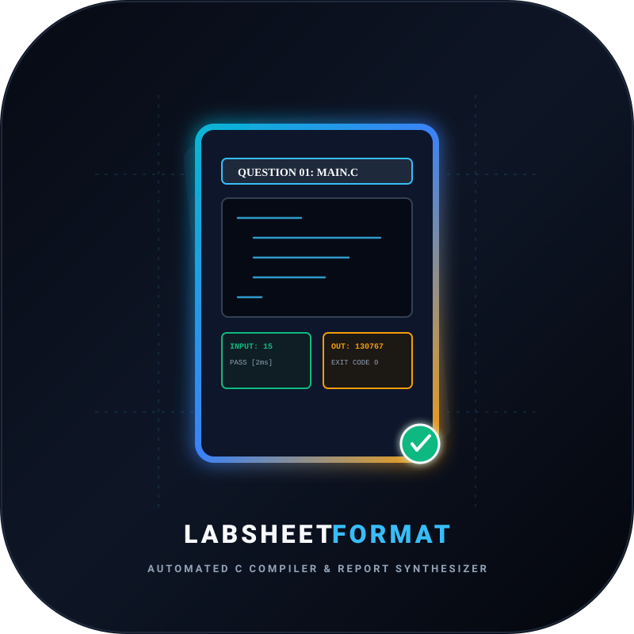

<p align="center">
  
</p>

<h1 align="center">LabsheetFormatMaker</h1>

<p align="center">
  <strong>Automated C Code Compilation, Sandboxed Testcase Execution, &amp; Academic Word/PDF Report Generator.</strong>
</p>

<p align="center">
  <a href="LICENSE"></a>
  
  
  
  <a href="future.md"></a>
</p>

---

## ⚡ Overview

**LabsheetFormatMaker** is an automated developer tool engineered to **compile, execute, test, and style university programming lab sheets** in seconds. Instead of spending hours manually copying code, running programs, taking terminal screenshots, and wrestling with Word tables, LabsheetFormatMaker automates the entire reporting lifecycle:

1. **Compiles** each `.c` source file dynamically using `gcc`.
2. **Actuates sandboxed subprocesses** with randomized test inputs.
3. **Captures and isolates stdout/stderr streams**, stripping user prompt noise.
4. **Synthesizes a beautifully styled Word document (`.docx`)** with narrow margins, Courier New monospace code containers, and dual-column testcase execution cards.
5. **Converts the document to PDF** instantly for ready-to-submit laboratory assignments.

---

## ⚙️ How the Pipeline Works

```mermaid
flowchart TD
    subgraph Input Layer [Sources]
        A["lab_folder/ (*.c)"] -->|Scan Files| B["Directory Parser"]
    end
    
    subgraph Execution Layer [Compilation & Testing]
        B -->|GCC Compilation| C["Binary Executables"]
        C -->|Inject Random Inputs [5-25]| D["Subprocess Runner"]
        D -->|Capture & Strip Prompts| E["Structured Stdout/Stderr Logs"]
    end
    
    subgraph Formatting Layer [Document Synthesis]
        E & B -->|python-docx Builder| F["Word Styling Engine"]
        F -->|Borders & Page Layouts| G["lab_report.docx"]
    end
    
    subgraph Output Layer [Publishing]
        G -->|docx2pdf Converter| H["lab_report.pdf"]
    end
```

---

## ⚡ Core Features

*   **Sandboxed Auto-Execution:** Compiles code on-the-fly and runs randomized test cases automatically.
*   **Prompt-Isolation Algorithm:** Identifies common console prompt suffixes (e.g., `"Enter a number: "`) and strips them from testcase cards.
*   **Courier New Code Blocks:** Preserves perfect indentation and brackets within framed monospace containers.
*   **Times New Roman Question Titles:** Renders clean academic question headers adhering to university submission guidelines.
*   **Dual-Column Testcase Matrices:** Generates side-by-side execution cards displaying inputs, outputs, and execution statuses.

---

## 📐 Document Spacing & Typography Specifications

| Section | Description | Font & Size | Border / Styling |
| :--- | :--- | :--- | :--- |
| **Cover Buffer** | ~10 empty lines at the top of page 1 | Times New Roman | Spacing for photos, names, and IDs |
| **Question Title** | `"Question N: <FileName>"` | **Times New Roman, 12pt, Bold** | Part of the main code container |
| **Code Box** | The raw `.c` file source code | **Courier New, 10pt** | Monospace container with single solid black borders |
| **Testcase Matrix** | Side-by-side execution cards | **Courier New, 10pt** | Dual columns with custom input & captured output |

---

## 🚀 Quick Start (Under 30 Seconds)

### 1. Prerequisites
Ensure you have `gcc` (GNU Compiler Collection) and Python 3.12+ installed.

### 2. Install Dependencies
```bash
git clone https://github.com/seeramsujay/LabsheetFormatMaker.git
cd LabsheetFormatMaker
pip install -r requirements.txt
```

### 3. Load Your C Files
Place all your `.c` source files inside the `lab_folder/` directory:
```bash
ls lab_folder/
# Output: Factorial.c  Fibonacci.c  PrimeCheck.c
```

### 4. Build Your Report
```bash
python generate_lab_report.py
```
This compiles every C file, runs test cases, formats the DOCX, and builds:
*   `output/lab_report.docx` (editable Microsoft Word report)
*   `output/lab_report.pdf` (print-ready PDF file)

---

## 🔮 Engineering Roadmap

To explore planned features including polyglot support (C++, Python, Rust), Typst sub-50ms PDF compilation, and AST-based academic plagiarism detection, read [future.md](future.md).

---

## 📄 License

This project is licensed under the **MIT License**. See `LICENSE` for details.
